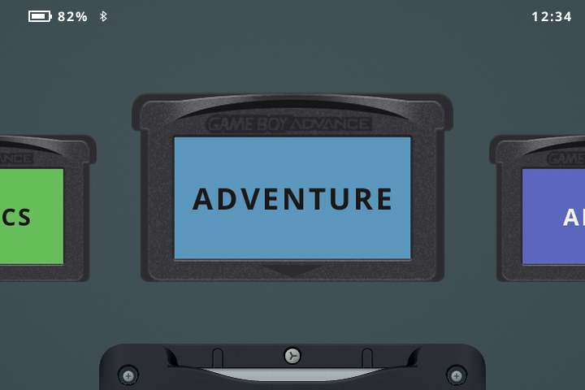
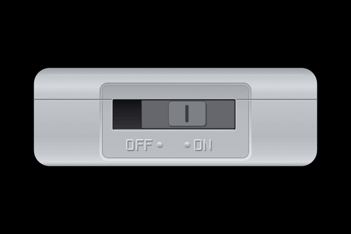

[Download](https://github.com/jgraving/slot/releases/latest) · [Setup guide](https://slot-cfw.fyi) · [Original project](https://github.com/BrandonKowalski/slot)

## slot, with a few more comforts

A Game Boy, Game Boy Color, and Game Boy Advance frontend for Anbernic handhelds. Browse your cartridges, choose a game, and watch it slide into the slot.

This fork builds on [Brandon Kowalski's slot](https://github.com/BrandonKowalski/slot) with an SP-inspired shell and some practical improvements for everyday play.

*Current UI previews rendered from production artwork and draw commands.*

## What's added in this fork

- **A coordinated SP shell.** Graphite, Platinum, Pearl Blue, and Pearl Pink finishes across the cartridge bay, power switch, and link port. Choose one in **General → Shell Color**, or follow your theme.
- **Larger cartridges.** Bigger labels on the carousel, with proportional shrinking as each cartridge seats in the slot. Soft movement ticks and a physical-style shutdown switch complete the feel.
- **Day and night settings.** **Select + X** switches between saved brightness/warmth presets on the carousel or in a game. Adjust either preset and it remembers your settings.
- **More audio choices.** A Sound menu for speaker, wired, Bluetooth, and detected USB audio. Each output remembers its volume and mute state; saved Bluetooth headphones can reconnect automatically. Disconnect volume defaults to silent.
- **Power options.** Choose light sleep, supported deep sleep, or shutdown on lid close, plus an optional shutdown timer while sleeping.
- **Tidier menus.** Scrolling settings, consistent button hints, and top-corner status indicators. Favorite removal asks for a second press, so an accidental tap does not lose your place.

The original shelves, Favorites and Recents, circuit-board core picker, mGBA/gpSP emulation, save states, and link interface remain. Upstream updates also bring global control/shortcut remapping, left-stick support on compatible devices, smoother ROM loading, and SD-card repair. Run-ahead has been removed following upstream’s fix for GBA flash-save corruption.

More detail: [Sound/Bluetooth](BLUETOOTH.md) · [Night display](NIGHT-DISPLAY.md) · [Power options](POWER-OPTIONS.md) · [Shell previews](previews/rgsp-shell-finishes.png) · [Design references](MATERIALS.md)

## Download and install

Get the current build from **[Releases](https://github.com/jgraving/slot/releases/latest)**. Downloads are public and do not require a GitHub account.

| Download | Purpose |
| --- | --- |
| [slot-System.zip](https://github.com/jgraving/slot/releases/latest/download/slot-System.zip) | Update an existing slot installation. Contains only `System`. |
| [slot-SD2.zip](https://github.com/jgraving/slot/releases/latest/download/slot-SD2.zip) | Full SD2 starter folder structure and defaults for a new setup. |
| `SHA256SUMS` / `build-info.json` | Verify downloads and identify the exact source/build. |

**Updating:** back up your card, shut down, and extract `slot-System.zip` onto the root of the content card (SD2), replacing the existing System files. Keep your games, saves, and configuration folders in place. Safely eject and boot.

**Starting fresh:** follow the [original slot guide](https://slot-cfw.fyi) for BaseOS setup, then use this fork's SD2 package. These downloads are not bootable OS images. The guide describes upstream slot; this fork's additions are documented above.

Put uncompressed ROMs in `Games/GB`, `Games/GBC`, or `Games/GBA`, with labels in the matching `Labels` folders. No ROMs or BIOS files are included. **`.zip` and `.7z` games are not supported.**

Code changes on this fork's `main` are built and regression-tested before publishing a release. Each release retains its own source tag, downloads, and checksums.

## Compatibility

This fork focuses on the SP experience. Audio testing includes RG SP and RG35XXSP; USB-C headphone playback is confirmed on RG SP. Bluetooth volume synchronization remains experimental, and hardware support varies. See [tested devices and audio limits](BLUETOOTH.md#tested-devices-and-known-limitations).

Upstream also supports RG34XX, RG34XXSP (without stick support), RG35XXSP, RG35XX Plus, RG28XX, and RG35XX-H. Every addition here has not been tested on every model. Physical link play and suspend/wake behavior need device-specific testing.

## Credits and license

Created by [Brandon Kowalski](https://github.com/BrandonKowalski/slot), with original skeuomorphic artwork by [MarkusMaribu](https://github.com/MarkusMaribu). Emulation by [mGBA](https://mgba.io) and [gpSP](https://github.com/libretro/gpsp). This fork adds shell/link artwork and interface, display, audio, and power refinements.

Development and documentation are AI-assisted, with human direction and review. Upstream also disclosed AI assistance for its frontend and website SVGs.

[GPL-3.0-or-later](LICENSE). Device packages include emulator licenses, provenance, patches, and gpSP source under `System/licenses`. Earlier upstream release notes are in [CHANGELOG.md](CHANGELOG.md).
