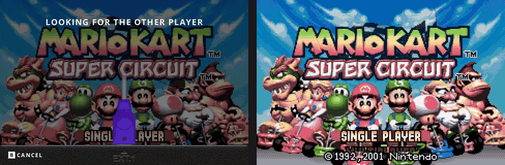

# slot.sp

**Your Game Boy shelf, made for the SP.**

Game Boy · Game Boy Color · Game Boy Advance

[Download](https://github.com/jgraving/slot/releases/latest) · [Setup guide](https://slot-cfw.fyi) · [Upstream slot](https://github.com/BrandonKowalski/slot)

Browse a shelf of cartridges, choose a game, and watch it slide into the slot. **slot.sp** builds on [Brandon Kowalski's slot](https://github.com/BrandonKowalski/slot), with an SP-inspired shell, larger cartridges, saved day/night settings, and more ways to listen and play.

*The slot.sp shell and shutdown sequence, rendered from the production artwork and draw commands.*

## See it in motion

*Carousel, core-picker and link recordings from upstream slot. These shared features are included in slot.sp; the recordings show upstream's shell artwork.*

## What makes slot.sp different

- **An SP-inspired shell.** Graphite, Platinum, Pearl Blue and Pearl Pink finishes across the cartridge bay, power switch and EXT.1 port. Choose one in **General → Shell Color**, or match your theme.
- **Cartridges with room to breathe.** Larger labels on the carousel, proportional shrinking during insertion, soft movement ticks, and automatic cleanup of detected black scan backgrounds around rounded labels. Your original PNGs stay untouched.
- **A smoother shelf.** Supported, verified panels can run at 120 Hz, with the carousel and menus targeting 120 FPS. Games and audio keep their native timing.
- **Day and night, remembered.** **Select + X** switches between saved brightness/warmth presets. Adjust either preset and it remembers your settings.
- **Your choice of audio.** Speaker, wired headphones, Bluetooth and detected USB audio, with separate volume and mute settings for each output. Saved Bluetooth headphones can reconnect automatically; disconnect volume defaults to silent.
- **Comfortable controls and power options.** Remappable shortcuts, scrolling menus, readable button hints, top-corner status indicators, favorite removal confirmation, and configurable lid-close sleep/shutdown behavior.

**Menu + X** takes a screenshot in game; **Select + X** remains the day/night shortcut. Both can be remapped.

Upstream updates bring screenshot capture and a gallery with zoom and multi-select, save/load undo, configurable loading and saving of states on insertion/ejection, periodic saves, core-load timeouts, SD-card repair, and emulator fixes. Favorites, Recents, the circuit-board core picker, mGBA/gpSP emulation and link play remain at the heart of it.

More detail: [Sound/Bluetooth](BLUETOOTH.md) · [Night display](NIGHT-DISPLAY.md) · [Power options](POWER-OPTIONS.md) · [Shell finishes](previews/rgsp-shell-finishes.png) · [Upstream sync notes](UPSTREAM-SYNC.md)

## Download and install

Get the current **slot.sp** build from [Releases](https://github.com/jgraving/slot/releases/latest). Downloads are public; no GitHub account is needed.

| Download | Use it for |
| --- | --- |
| [slot.sp-System.zip](https://github.com/jgraving/slot/releases/latest/download/slot.sp-System.zip) | Updating an existing installation. Contains only `System`. |
| [slot.sp-SD2.zip](https://github.com/jgraving/slot/releases/latest/download/slot.sp-SD2.zip) | The full SD2 starter folder structure and defaults for a new setup. |
| `SHA256SUMS` / `build-info.json` | Checking downloads and identifying the exact source/build. |

**Updating:** back up your card, shut down, and extract `slot.sp-System.zip` onto the root of the content card (SD2), replacing the existing `System` files. Keep your games, saves and configuration folders in place. Safely eject and boot.

**Starting fresh:** follow the [upstream installation guide](https://slot-cfw.fyi/installing/), then use this fork's SD2 package. These ZIPs are not bootable OS images. The guide describes upstream slot; the fork's additions are documented here.

Put uncompressed ROMs in `Games/GB`, `Games/GBC` or `Games/GBA`, with labels in the matching `Labels` folders. No ROMs or BIOS files are included. **`.zip` and `.7z` games are not supported.** Existing card paths and the `System/slot` launcher stay compatible. Older download names remain available as aliases.

Code changes are built and regression-tested on ARM64 before a release is published. Each release includes source identification, checksums, emulator provenance and licenses.

## Hardware notes

The fork focuses on the SP experience. The 120 Hz carousel has been confirmed smooth on a handheld, but **an internal-speaker buzz was reported after enabling 120 Hz and remains unresolved**. To compare with 60 Hz, shut down and set `high_refresh=0` in `Config/slot.state`. Set it back to `1` to restore high refresh. Unsupported panels stay at their normal refresh rate.

Audio testing includes RG SP and RG35XXSP; USB-C headphone playback is confirmed on RG SP. Bluetooth volume synchronization remains experimental. Physical link play and deep sleep/wake need device-specific testing. See [audio limits](BLUETOOTH.md#tested-devices-and-known-limitations).

Upstream also supports RG34XX, RG34XXSP, RG35XXSP, RG35XX Plus, RG28XX and RG35XX-H. Every fork addition has not been tested on every model.

## Credits and license

Based on [slot by Brandon Kowalski](https://github.com/BrandonKowalski/slot), with original skeuomorphic artwork by [MarkusMaribu](https://github.com/MarkusMaribu). Emulation by [mGBA](https://mgba.io) and [gpSP](https://github.com/libretro/gpsp). High-refresh panel support is adapted from [Prashant Vaibhav's slot fork](https://github.com/pvaibhav/slot); BaseOS is also his work. slot.sp adds shell/link artwork and interface, display, audio, power and label-processing refinements.

Development and documentation are AI-assisted, with human direction and review. Upstream's disclosure is retained in its [credits](site/docs/credits.md).

[GPL-3.0-or-later](LICENSE). Device packages include emulator licenses, provenance, patches and gpSP source under `System/licenses`. Upstream release notes are in [CHANGELOG.md](CHANGELOG.md).
