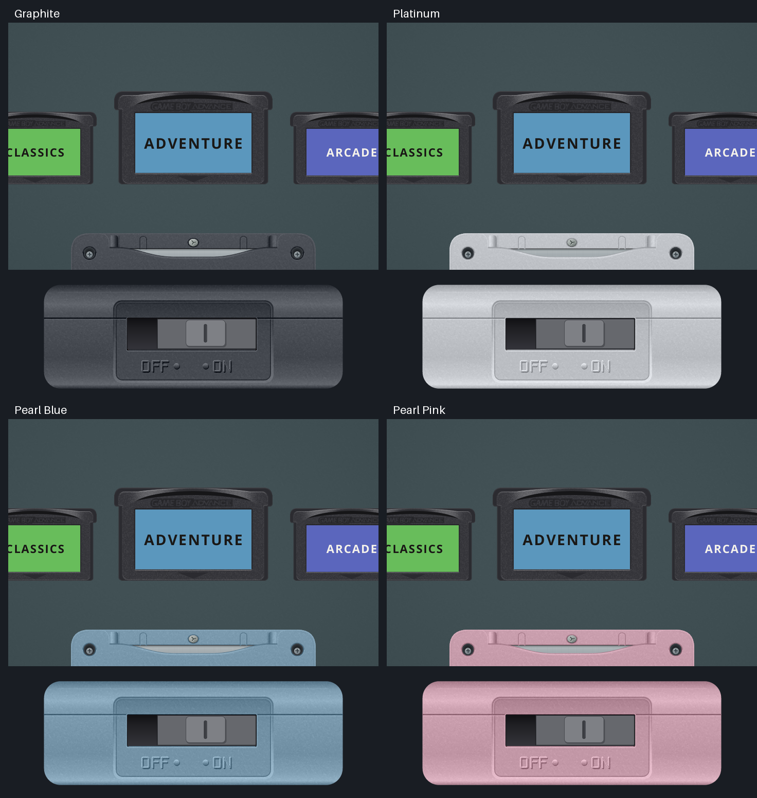
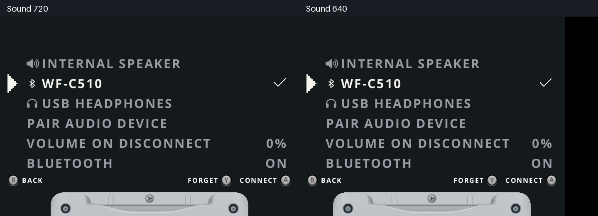
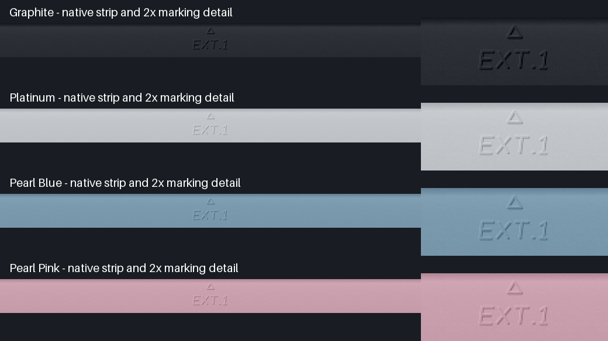

**The feeling of your old Game Boy. The comforts of your new handheld.**

[Explore the finishes](#make-it-your-sp) · [Get started](#get-started) · [Original slot guide](https://slot-cfw.fyi)

## Pick a cartridge. Settle into a game.

slot turns an Anbernic handheld into a little home for your Game Boy, Game Boy Color, and Game Boy Advance collection. Browse a shelf of cartridges, choose a game, and watch it slide into an SP-inspired slot. Familiar shapes, soft movement sounds, and small physical details make choosing what to play part of the pleasure.

This is **jgraving's fork of [Brandon Kowalski's slot](https://github.com/BrandonKowalski/slot)**. It builds on that wonderful idea with a reworked cartridge bay, coordinated shell finishes, more comfortable display settings, and audio controls made for everyday use. The goal is a handheld that feels personal, familiar, and easy to live with.

## Make it your SP

Choose **Graphite, Platinum, Pearl Blue, or Pearl Pink** in **General → Shell Color**, or let the shell follow your theme. The cartridge bay, power switch, and link port share the same finish.

The rebuilt housing draws from the real SP: rounded shoulders slope into a recessed metal slot, tiny screws sit in their wells, and fine painted-plastic grain catches the light. A quiet petrol wallpaper gives the cartridges room to stand out. Even the link port has a matching molded **EXT.1** mark.

Cartridges are larger on the shelf so their labels are easier to enjoy. When you launch a game, they shrink smoothly to their insertion size. Each format keeps its proportions, and the narrower GB and GBC bodies seat at the same width as the lower body of a GBA cartridge. The details matter because the whole thing should feel like it belongs together.

## Small comforts that make a big difference

- **A display for daytime and bedtime.** Press **Select + X** on the carousel or in a game to switch between saved day and night brightness/warmth settings. Night starts dim and warm; adjust either preset and slot remembers it.
- **Your headphones, your settings.** Choose the speaker, wired headphones, Bluetooth headphones, or a detected USB audio output from Sound. Volume and mute are remembered separately for each output. Saved Bluetooth headphones can reconnect automatically.
- **A quiet landing when headphones disconnect.** The return volume defaults to silent, with a setting to choose another level. Unplugging or losing a connection should not surprise everyone around you.
- **Sleep the way you want.** Choose light sleep, deep sleep where supported, or power off when closing the lid. An optional shutdown timer runs while sleeping. A matching physical-style power switch finishes the shutdown animation.
- **Menus with room to breathe.** Six visible rows, scrolling when needed, proportional button icons, and consistent hints keep longer settings pages manageable. The clock, battery, and connection indicators stay in the top corners.
- **Favorites worth keeping.** A gold star marks your favorites, and removing one takes a second confirmation so an accidental press does not undo your collection.

Read more about [Sound and Bluetooth](BLUETOOTH.md), [day/night display presets](NIGHT-DISPLAY.md), [power options](POWER-OPTIONS.md), and the [materials and hardware references](MATERIALS.md).

## Still slot at heart

The original project's strengths remain: GB, GBC, and GBA shelves; Favorites and Recents; the cartridge circuit-board core picker; mGBA and gpSP; save states and playback conveniences; and its playful link connection interface. This fork carries those ideas forward with a consistent look across the carousel, settings, power switch, and cable/wireless connection screens.

## Get started

**New to slot?** Start with the [original installation and user guide](https://slot-cfw.fyi) for the BaseOS/SD-card setup. That guide describes the upstream project; the additions shown here require a build from **this fork**.

**Already running slot?** The [validated ARM64 build for these changes](https://github.com/jgraving/slot/actions/runs/39045823088) includes a downloadable artifact with a `System` update ZIP. GitHub requires sign-in to download Actions artifacts, and those downloads expire. Older entries on the fork's Releases page may predate the features shown here.

1. Back up your card, especially your games, saves, and configuration, and shut down the handheld.
2. Extract the `System` update ZIP and copy its `System` folder onto the root of the slot content card (SD2), replacing the existing System files. Keep your other folders in place. This ZIP is an application update, not a bootable OS image.
3. Safely eject the card, boot slot, and choose your finish under **General → Shell Color**.

Put uncompressed ROMs in `Games/GB`, `Games/GBC`, or `Games/GBA`. Labels go in the corresponding `Labels` folders.

> [!IMPORTANT]
> slot supports **GB, GBC, and GBA only**. ROMs must be unzipped; `.zip` and `.7z` files are not read.

### Hardware and current limits

The SP experience is the focus of this fork. Audio testing has included RG SP and RG35XXSP; USB-C headphone playback is confirmed on RG SP. Available outputs and sleep behavior depend on the device. Bluetooth volume synchronization remains experimental: some headphones still need their own volume adjusted. See [audio compatibility notes](BLUETOOTH.md#tested-devices-and-known-limitations).

Upstream also lists RG34XX, RG34XXSP (without stick support), RG35XXSP, RG35XX Plus, RG28XX, and RG35XX-H. That inherited support does not mean every addition here has been tested on every model. Physical link play and suspend/wake behavior also need device-specific testing.

The merged visual/audio build passed **534 Rust regression tests and 56 Bluetooth tests**, with slot, mGBA, and gpSP verified as native AArch64 binaries. Automated coverage complements handheld testing; it does not establish compatibility with every accessory or game.

## Built on work we love

[Brandon Kowalski](https://github.com/BrandonKowalski/slot) created slot and its Game Boy-focused experience. [MarkusMaribu](https://github.com/MarkusMaribu) contributed the original skeuomorphic artwork. The [mGBA](https://mgba.io) and [gpSP](https://github.com/libretro/gpsp) teams make the emulation possible. This fork builds on their work with new shell and link-port artwork, interface refinements, and display, audio, and power improvements.

Development is AI-assisted. Upstream disclosed AI assistance for its Rust frontend and website SVGs; this fork also uses AI assistance for code, artwork expressed in code, tests, and documentation, with human direction and review.

slot is distributed under [GPL-3.0](LICENSE). Emulator licenses and the corresponding bundled source materials are included under `System/licenses` in device packages. Earlier upstream release notes remain in [CHANGELOG.md](CHANGELOG.md); the linked feature documents describe this fork's additions.
